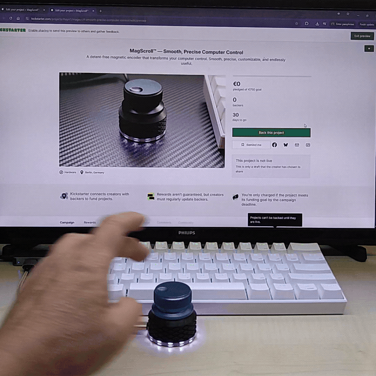
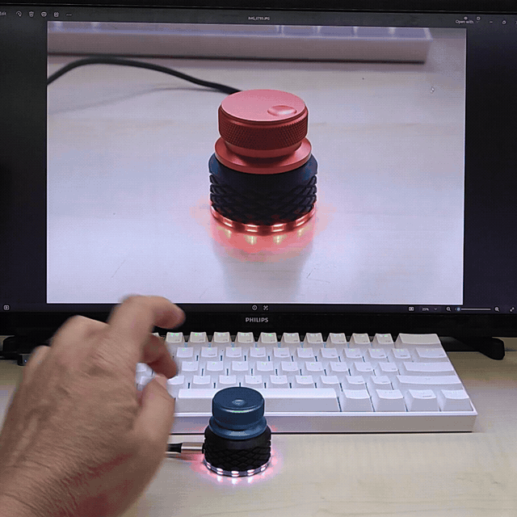
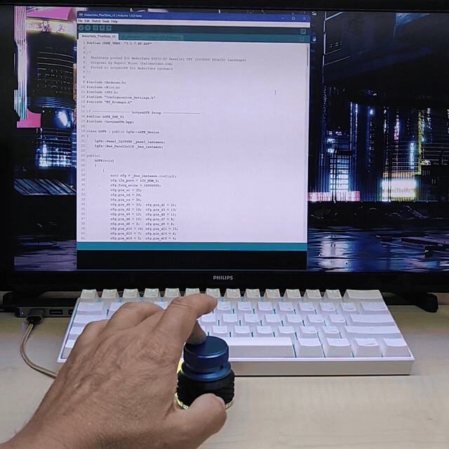

# MagScroll™ – Smooth, Precise Computer Control

<!-- Product Images -->

  

MagScroll™ is a precision magnetic control knob designed to give you a smoother, more intuitive way to interact with your computer.

This repository contains the MagScroll™ companion app, firmware files, documentation, and other resources for existing MagScroll™ owners and for everyone discovering MagScroll™ now.

---

## 🚀 Current Kickstarter Campaign

MagScroll™ is back on Kickstarter.

👉 **[MagScroll™ — Smooth, Precise Computer Control](https://www.kickstarter.com/projects/ihayri1/magscroll-smooth-precise-computer-control)**

The MagScroll™ Kickstarter campaign is now LIVE! You can support the project and follow its progress here.

---

## 🎬 See MagScroll in Action

These short animations demonstrate how MagScroll provides smooth, precise control in different applications.

### Webpage Scrolling

### Image Zooming

### Code Scrolling

---

## The Newest Function: VFD Spindle Speed Control

Control your spindle speed, including turning it ON and OFF.

You can see it in this video:

https://youtu.be/Pd_zzcSXB4o

---

## 🎉 Thank You to All Backers

A huge thank you to all my backers on Kickstarter who helped make MagScroll™ a real product.

Your support turned this idea into a manufactured product that has already been delivered to backers around the world. I’m incredibly grateful.

The current Kickstarter campaign is funding the next production run of MagScroll™.

---

## 📘 User Manual (PDF)

You can find the MagScroll™ user manual here:

👉 **[MagScroll User Manual](MagScroll_User_Manual.pdf)**

---

## 🔔 Firmware Updates

To ensure you always have access to the latest firmware, please note the following:

The **Firmware** folder in this GitHub repository contains the latest compiled firmware files for MagScroll™.

The two main firmware versions are:

- **MagScroll_HD.hex** – Full MagScroll HD firmware, supporting high-resolution vertical and horizontal scrolling, with double-tap mode switching.
- **MagScroll_Vert.hex** – Vertical-only firmware. Horizontal mode and double-tap mode switching are disabled.

The Firmware folder also contains dedicated firmware files for other MagScroll functions:

- **MagCNCAxisJog.hex** – CNC axis jogging
- **MagScroll_MIDI.hex** – MIDI control
- **MagSpindle.hex** – VFD spindle speed control
- **MagTimer.hex** – Timer control
- **MagVideoScroll.hex** – Video control
- **MagVLCSeek.hex** – VLC media seeking
- **MagVolume.hex** – Volume control

Firmware included inside older zipped companion app packages may be older versions and is kept for compatibility.

For the newest features, improvements, and bug fixes, always use the firmware from this GitHub repository.

---

## 📥 Companion App (Windows)

The MagScroll™ companion app allows you to configure and customize your MagScroll™, including switching between different control functions.

Available versions:

- **MagScrollAppV6.zip** – Latest test version. Feedback welcome.
- **MagScrollAppV5.zip** – Alternative version if you encounter issues.
- **MagScrollTest.zip** – Older test version.

The repository also contains the firmware and supporting files required by the different app versions.

If you encounter any problems, the more detailed information you can provide, the better I can troubleshoot and improve the app.

---

## 📂 Repository Contents

- **MagScrollAppV6.zip** – Latest test version of the companion app.
- **MagScrollAppV5.zip** – Alternative version if you encounter issues.
- **MagScrollTest.zip** – Test version of the companion app.
- **Firmware/** – Compiled firmware files for updating your MagScroll™ device.
- **Documentation/** – Setup instructions and usage notes.
- **MagScroll_User_Manual.pdf** – User manual.

---

## 🛠 Feedback & Support

If you encounter bugs, have suggestions, or want to share your experience, please open an Issue here on GitHub or contact me directly.

Your feedback helps improve MagScroll™.

---

## 🌟 MagScroll™ on Kickstarter

Follow the current Kickstarter campaign for updates and information about the next production run:

👉 **[MagScroll™ — Smooth, Precise Computer Control](https://www.kickstarter.com/projects/ihayri1/magscroll-smooth-precise-computer-control)**

Thank you for being part of the MagScroll™ journey!

### Acknowledgements

Special thanks to **Stefan** for identifying the application freezing issue and providing his script for Mac users. His contribution helped address an important compatibility problem.

Thanks to **Tobias** for pointing out the possibility of high-resolution scrolling and providing the ESP32 code that inspired further development of this functionality.

Thanks, Stefan and Tobias!